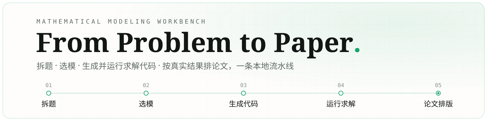
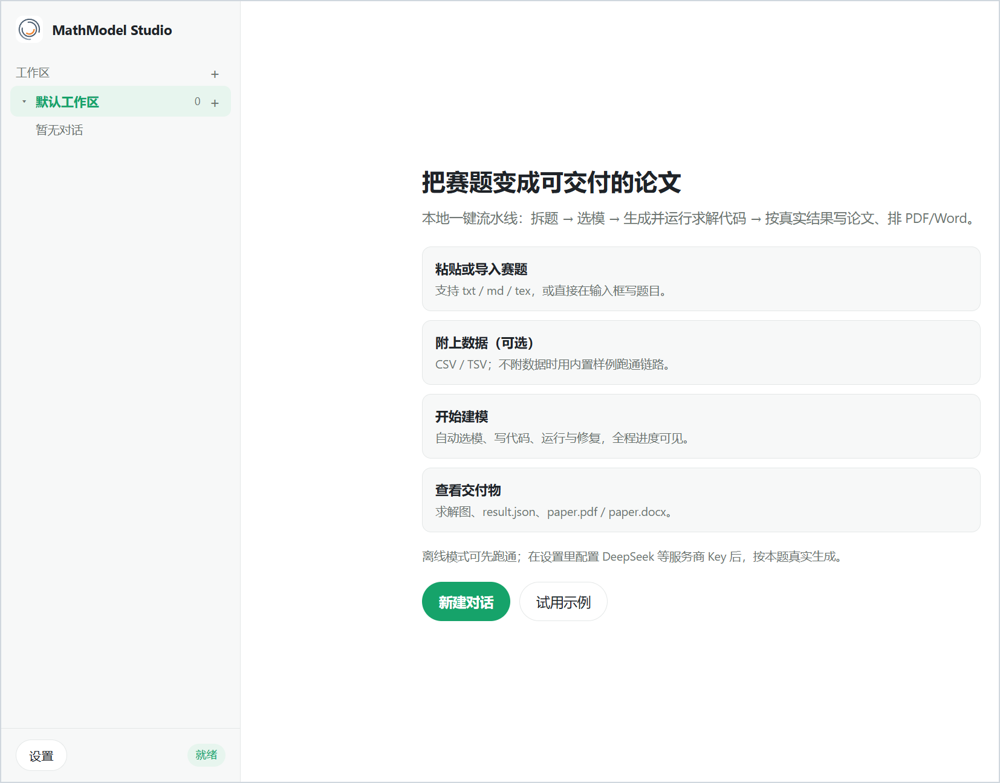
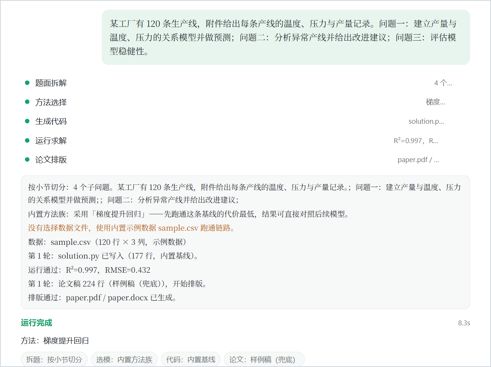
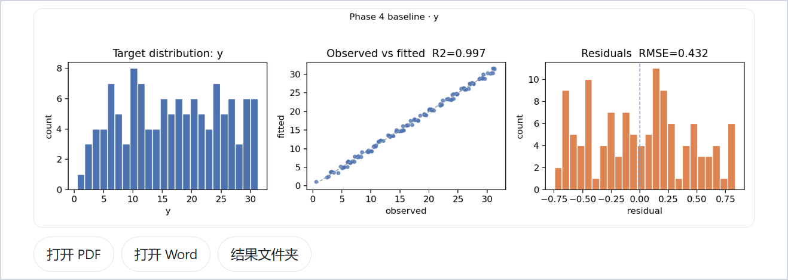

  <picture>
    <source media="(prefers-color-scheme: dark)" srcset="assets/readme-hero-dark.svg">
    
  </picture>

<h1 align="center">MathModel Studio</h1>

<i>把赛题变成可交付的论文。</i>

  桌面端数学建模工作台：输入赛题与数据，自动完成题面拆解、方法选择、求解代码生成与运行、论文排版。 
  界面为极简聊天式：左侧「工作区 → 对话」树，中部对话流与首开欢迎引导。

  
  
  
  
  

  <a href="#界面">界面</a> ·
  <a href="#工作流">工作流</a> ·
  <a href="#运行方式">运行方式</a> ·
  <a href="#环境要求">环境要求</a> ·
  <a href="#数据与隐私">数据与隐私</a> ·
  <a href="#配置服务商">配置服务商</a> ·
  <a href="#目录">目录</a> ·
  <a href="#参与贡献">参与贡献</a> ·
  <a href="#许可">许可</a>

---

## 界面

  

欢迎页：左侧「工作区 → 对话」树，中部首开引导与示例入口。

  

一次完成的运行：五段轨道、实时日志与摘要（离线示例，8.3 秒）。

  

交付物：本次运行真实求解图，以及 PDF / Word / 结果文件夹入口。

取图口径：实际界面、1.5 倍像素密度、按面板裁切；日志卡为展示全文临时放开高度上限。

## 工作流

1. **题面拆解**：模型把赛题拆成子问题；模型不可用时按小节切分。
2. **方法选择**：模型给出三条候选并标出推荐，直接采用推荐；失败时用内置方法族。
3. **生成代码**：按题面、所选方法与数据画像生成 `solution.py`，契约固定为 `--data` / `--out`，须写出 `result.json` 与 `figure.png/pdf/svg`。
4. **运行求解**：执行脚本；失败把 stderr 与上一版代码回喂模型，最多 3 轮。
5. **论文排版**：按真实 `result.json` 与求解图写 `paper.tex`，xelatex 编译 PDF、pandoc 转 Word；编译失败回喂修复，最多 3 轮。

所有论文数值只来自本次运行的 `result.json`。没有可用模型时进入离线模式：内置基线脚本 + 样例稿，事件与界面会标明兜底，不冒充按本题生成。

## 运行方式

| 方式 | 命令 | 说明 |
| --- | --- | --- |
| 桌面开发 | `npm install` → `npm run dev` | 启动 Electron 与本地 Python 运行时 |
| 无界面跑一遍 | `python modeling/cli.py run --problem-file 题面.txt [--data 数据.csv] [--out 目录]` | 事件按 JSON Lines 输出；默认离线模式 |
| 类型检查 | `npm run typecheck` | 主进程、preload、渲染层全覆盖 |
| 构建 | `npm run build` | 产物在 `desktop/out/` |
| 真启动冒烟 | `npm run smoke:window` | 起生产入口，断言窗口、运行时与界面文本 |
| 打包 | `npm run vendor:python`、`npm run vendor:pandoc` → `npm run dist:win` | 随包 Python 与 pandoc，输出 NSIS 安装包 |

## 环境要求

- Node.js 22 及以上。
- Python 3.12 及以上，并安装 `modeling/requirements.txt`（`numpy`、`matplotlib`）。
- 生成 PDF 需要本机 `xelatex`；转 Word 需要 `pandoc`。缺失时求解结果仍保留，论文步骤会明确报缺。
- 主平台为 Windows；macOS / Linux 可开发运行，未做安装包验证。

## 数据与隐私

- API Key 用系统安全存储（Electron `safeStorage`）加密保存，运行时按次传给本机进程；不落日志、不进事件、不写入运行目录。
- 每次运行的代码、结果、论文都在用户数据目录的 `runs/<时间戳>/` 下，界面提供「打开 PDF」「打开 Word」「结果文件夹」。
- 本地通道只绑定 `127.0.0.1`，每个请求校验随机 token 与 Host/Origin；主进程不把端口和 token 交给渲染层。
- 服务商地址默认 https；自定义端点若用 http，只接受回环地址。

## 配置服务商

设置弹窗内置 DeepSeek、通义千问、Kimi、智谱 GLM、OpenAI 格式端点与离线模式。预设模型与地址在 `gateway/src/mms_gateway/providers.json`，可自行增改。

- 真实服务商需要填写模型名与 API Key。
- 自定义端点填到 `/v1` 为止，公网必须 https。
- 离线模式不需要 Key，用于先跑通整条链路。

## 目录

根目录是 npm workspace，只做脚本转发；数模领域、通用通道与桌面端各自独立。

| 路径 | 内容 |
| --- | --- |
| `modeling/cli.py` | serve / run 入口，装配 modeling + gateway |
| `modeling/src/mms_modeling/pipeline.py` | 一键流水线 |
| `modeling/src/mms_modeling/baseline.py` | 数据画像、基线脚本、执行与产物收集 |
| `modeling/src/mms_modeling/paper_gen.py` / `paper_build.py` | 论文生成与排版 |
| `modeling/src/mms_modeling/templates/` | 论文骨架与写作规范 |
| `modeling/skills/` | 技能包：core / methods / figure / diagram / paper / deai / score（领域资产，当前一键流水线尚未调用） |
| `gateway/src/mms_gateway/server.py` | 本机 HTTP + SSE 通道，runner 由外部注入 |
| `gateway/src/mms_gateway/provider.py` | OpenAI 兼容流式客户端 |
| `gateway/src/mms_gateway/llm.py` | JSON / 文本调用与重试 |
| `gateway/src/mms_gateway/providers.json` | 预设服务商与模型 |
| `desktop/src/main/` | 通道、设置、文件选择、产物打开 |
| `desktop/src/preload/` | 窄 IPC 接口 |
| `desktop/src/renderer/` | 极简聊天式界面（工作区/对话树 + 欢迎引导 + 对话流） |
| `desktop/src/shared/` | 共享类型 |
| `desktop/tests/window-smoke.cjs` | 真启动冒烟 |
| `desktop/scripts/prepare-vendor.mjs` | 随包 Python / pandoc 准备 |
| `desktop/build/` | 图标与安装向导图 |
| `vendor/` | 随包 Python / pandoc（本机生成，不入库） |

## 参与贡献

欢迎 Issue 与 PR。报问题请附版本号、Windows 版本、复现步骤与日志；改代码前先开 Issue 对齐方向。提交前跑 `npm run typecheck` 与 `npm run build`，并在 PR 描述里写明验证方式。提交 PR 即表示同意按本仓库许可（AGPL-3.0-only）分发贡献。

## 许可

AGPL-3.0-only。第三方组件与分发说明见 `THIRD_PARTY_NOTICES.md`。