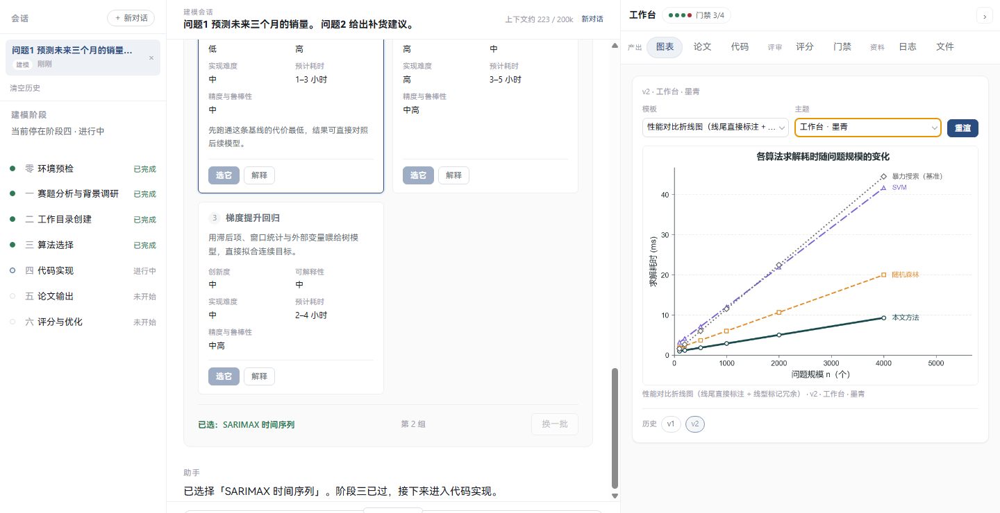
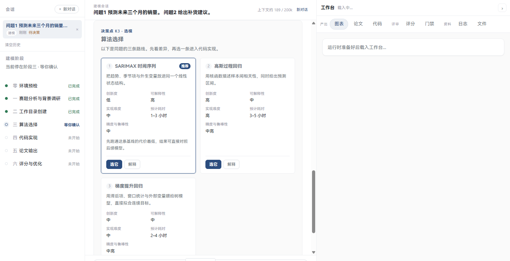
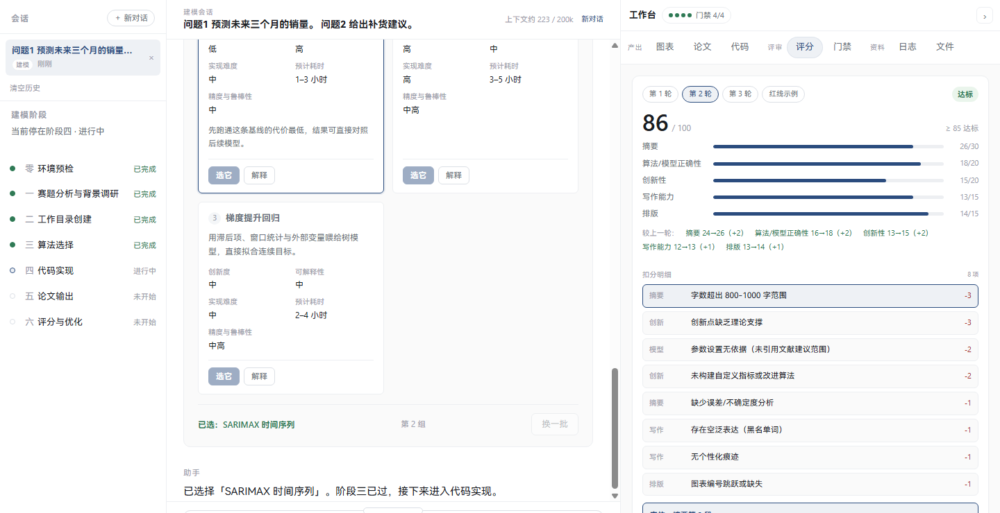
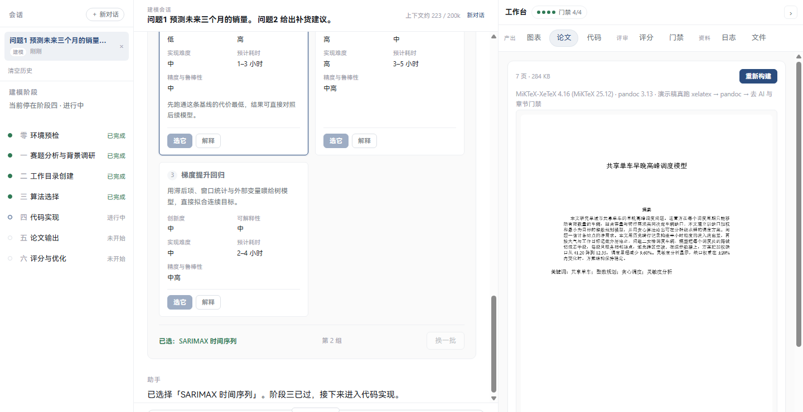
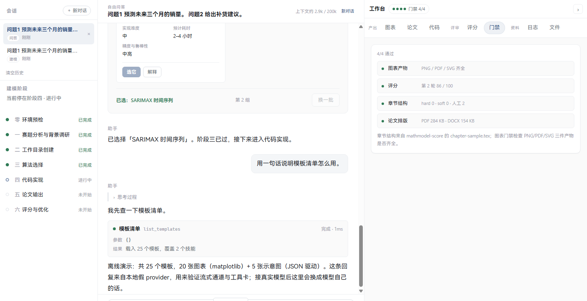
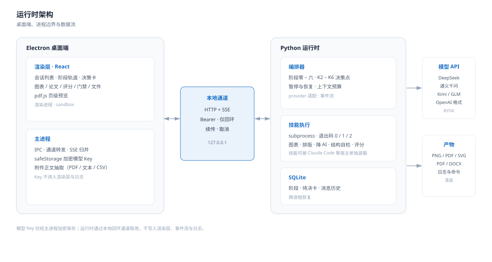
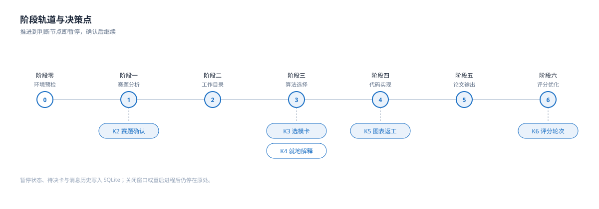

<h1 align="center">MathModel Studio</h1>

<p align="center"><b>面向数学建模竞赛的本地桌面 Agent · 人在环的建模工作台</b></p>

<p align="center">
  从赛题到论文，关键判断保留给使用者：<br>
  选模依据、方案解释、门禁结论与评分明细均可见、可追问、可回滚。
</p>

<p align="center">
  
  
  
  
</p>

<p align="center">
  <b>简体中文</b> &nbsp;·&nbsp; <a href="README_EN.md">English</a>
</p>

---

<p align="center">
  
</p>

> **设计原则**：可自动校验的环节交由门禁，需要判断的环节留给人，并将判断点落实为界面。
>
> 本工具将契约化技能集（出版级图表、排版规范、AI 痕迹检查、结构自检与评分）集成于本地桌面程序：模型由使用者提供，数据不出本机，过程可审计。

## 概览

MathModel Studio 面向已经完成或正在推进建模工作的参赛者与研究者。它不替代建模判断，而是把阶段推进、模型选择、图表返工、论文排版与交付检查组织为一条可审计的工作流。

- **本地优先**：桌面端与 Python 运行时均在本机执行，模型 Key 经系统安全存储加密保存。
- **人在环**：阶段推进在关键节点暂停并等待确认，暂停状态可跨进程恢复。
- **契约驱动**：技能由注册表、JSON Schema 与 CLI 退出码约束，界面从注册表生成，而非硬编码技能清单。
- **证据可复核**：门禁、评分与 CI 断言均提供读数与反向覆盖。

## 界面

截图为 1440×900 下的实际界面，会话内容来自离线演示，不包含真实赛题或密钥。

| 选模与解释 | 评分与扣分定位 |
| --- | --- |
|  |  |
| K3 选模卡：候选路线、字段对齐与「选它 / 解释」 | K6 评分：五维得分、扣分明细与正文定位 |

| 论文排版 | 对话与工具卡 |
| --- | --- |
|  |  |
| 论文页：xelatex → pandoc → 三道门禁与页级预览 | 对话流、工具卡与四项门禁结果 |

## 当前状态

**0.6.0（2026-10-31）**。本版本引入多会话管理，DeepSeek、通义千问、Kimi、智谱 GLM 与 OpenAI 格式五类模型入口，200k / 400k / 1m 上下文预算，中 / 高 / 最大思维深度，以及可收起的右侧工作台。

论文页执行完整排版链路：xelatex 两遍 → pandoc 转 DOCX → Word 版式后处理 → 去 AI 措辞、结构指标与章节结构三道门禁；PDF 使用 pdf.js 做页级预览。当前编译对象为仓库内置演示稿，阶段机不会因构建成功自动将阶段五标记为通过。

M6 打包已接线：electron-builder 配合随包便携 Python 与 pandoc，NSIS x64 安装包已在本机构建；尚未在干净机器上安装验证。

里程碑见 [PLAN.md](PLAN.md) §7；已验证结论与未证事项见 [docs/HANDOFF.md](docs/HANDOFF.md)。

## 快速开始

```bash
# 安装依赖。大陆网络环境请先阅读 docs/env-setup.md：npm 直连与 github.com 均不稳定
npm install
python -m pip install -r requirements.txt -i https://pypi.tuna.tsinghua.edu.cn/simple/

# 启动桌面端。无 Key 时可加 MMS_FAKE_PROVIDER=1 使用离线演示
MMS_FAKE_PROVIDER=1 npm run dev

# 不接入模型也可验证运行时：列出 25 个模板并渲染一张图（PNG/PDF/SVG）
npm run mms -- templates
npm run mms -- invoke figure paired-raincloud

# 运行全部本地门禁：注册表、技能规范、反向覆盖、类型检查、构建、产物冒烟、契约、CLI、通道、工作台与论文
npm run gate
```

`npm run gate` 通过表示脚手架自洽，不依赖网络与显示器。论文自检需要本机安装 `xelatex` 与 `pandoc`（见「依赖」）。

## 核心能力

### 阶段编排与决策点

上游阶段零至阶段六（环境预检、赛题分析、工作目录、算法选择、代码实现、论文输出、评分优化）映射为一条状态轨道，可直接看到当前阻塞位置。关键节点以决策卡暂停：

- **K2 赛题与附件确认**：子问题拆分、附件与数据角色、逐问数据对应关系。
- **K3 选模卡**：2–3 个候选方案，含核心思路、创新度、可解释性、实现难度、预计耗时与精度预期；支持换一批。
- **K4 就地解释**：打开解释抽屉而不清除待选状态。
- **K5 图表返工**：换模板、换主题、重渲与回滚；重渲后仅展示当前版本，旧版本进入历史。
- **K6 评分与优化轮次**：五维评分、扣分定位、三轮熔断与一票否决。

### 会话与上下文

左栏为会话列表：建模会话从 SQLite 读取，问答会话保存在本地；支持新建、切换、单条删除与清空。切换时恢复消息、附件、阶段与待决卡。中栏顶部显示当前会话与上下文用量，按 200k / 400k / 1m 预算从最新消息回溯装载。

### 模型接入

设置页以服务商列表组织五类入口，模型名可按预设选择或手动填写。Key 仅经主进程 `safeStorage` 加密落盘；未配置 Key 时可运行离线演示。详见 [docs/providers.md](docs/providers.md)。

### 图表与论文

图表工作台真实调用渲染器输出 PNG/PDF/SVG，并保留可复现命令与运行日志。论文页完成 xelatex、pandoc、Word 版式后处理与三道交付门禁，PDF 以 pdf.js 逐页预览。

### 文件与工作区

「文件」页列出工作区内容并支持切换目录；工作区默认位于桌面「赛题」，首次启动时创建。附件可在中栏直接拖入或粘贴，主进程负责抽取正文（PDF 使用 pdfjs，文本与 CSV 直读并报告行列）。

## 架构

<p align="center"></p>
<p align="center"></p>

桌面端与 Python 运行时通过本地回环通道（HTTP + SSE）通信，模型 Key 仅由主进程加密保存。阶段推进在 K2–K6 决策点暂停，状态、待决卡与消息历史写入 SQLite，可跨进程恢复。

## 技能矩阵

单一事实源为 [`skills/manifest.json`](skills/manifest.json)；下表行数与徽章计数由 CI 强校验一致。

| 技能 | 职责 | 状态 |
| --- | --- | --- |
| [`mathmodel-core`](skills/mathmodel-core/) | 阶段零至阶段六编排与路由 | 内置 |
| [`mathmodel-methods`](skills/mathmodel-methods/) | 建模方法库与选型：问题族索引、选型依据、验证方式 | 内置 |
| [`mathmodel-paper`](skills/mathmodel-paper/) | 论文写作与排版：写作规范、LaTeX 骨架、Word 输出、参考文献 | 内置 |
| [`mathmodel-figure`](skills/mathmodel-figure/) | 数据图表：matplotlib 模板库与 Nature 出图标准 | 内置 |
| [`mathmodel-diagram`](skills/mathmodel-diagram/) | 学术示意图：JSON 驱动版式模板与高保真复刻 | 内置 |
| [`mathmodel-deai`](skills/mathmodel-deai/) | 降 AI 与交付核查：词表级、结构级、字符级三道门禁 | 内置 |
| [`mathmodel-score`](skills/mathmodel-score/) | 结构自检与评分：章节门槛与百分制五维评分卡 | 内置 |

七个技能以源码形式随仓库分发（Apache-2.0），版本与引入记录见 [`skills/VENDOR.md`](skills/VENDOR.md)。运行时仅通过 subprocess 调用技能脚本并按退出码判定，因此每个技能仍可被 Claude Code 等宿主单独装载与使用。

## 质量门禁与证据

每条门禁均配置反向覆盖：仅返回通过结果的检查器不构成证据。

| 门禁 | 判据 | 反向覆盖 |
| --- | --- | --- |
| G1 注册表一致 | 注册表、技能目录、契约词表与两份 README 的技能表及徽章计数一致 | 8 种破坏逐项注入，必须变红（`npm run check:registry:negative`） |
| G8 技能规范 | 每个技能的 `SKILL.md` 为合法 Agent Skills 入口：frontmatter 可解析、名称与目录一致、描述非空且在 1024 字内、无仓库私有字段 | 6 种基于真实文件的破坏必须变红（`npm run check:skills:negative`） |
| G2 契约校验 | 注册表按 JSON Schema Draft 2020-12 校验；`jsonschema` 缺席时降级并说明 | 两份非法注册表必须被拒 |
| G2b 版本同源 | `VERSION`、`package.json`、`pyproject.toml`、`mms/__init__.py` 四处一致 | 任一缺项或取值不同即失败 |
| G3 CLI 契约 | 退出码 0/1/2 均可达；实际调用渲染器并核验 PNG/PDF/SVG 三件产物 | 词表外取值、非法 JSON、空 `MMS_HOME`、未知子命令/模板与渲染器假成功均被拦截（`runtime/selfcheck.py`） |
| G4 事件流 | 握手、Bearer token、回环 Host/Origin 白名单、九类 SSE 事件、续传与取消；覆盖 K2/K3 暂停恢复与跨进程恢复；0.6.0 增加思维深度、关闭开关与上下文裁剪（52 条） | 10 种坏事件必须被拒；无 token、错误 Host、无待决恢复均被拒（`python runtime/selfcheck_channel.py --selftest`） |
| G5 provider 离线契约 | 本地假端点覆盖 429 退避、`reasoning_content` 分离、分片 `tool_calls` 拼装、历史剥离与 Key 传递边界 | Key 哨兵不得进入事件流与 stderr；未开启离线模式时假 provider 被拒 |
| G6 桌面骨架 | 类型检查、构建，并校验产物包含本项目中文文案与设计令牌 | 断言失败即退出 1（`scripts/smoke-dist.mjs`） |
| G9 工作台 | 真实渲染两版图、版本历史与回滚，未知模板/主题/版本不落版本；三轮评分、扣分定位、章节样例与一票否决（13 条） | 未知模板/主题/版本均为反向控制（`runtime/selfcheck_workbench.py`） |
| G10 论文排版 | xelatex 两遍 → pandoc → Word 后处理：PDF/DOCX 文件头与体积、六个步骤、三道门禁、状态落盘（10 条） | 缺件、坏稿、坏 TeX、缺稿件四条反向；`MMS_PAPER_SKIP=1` 才允许跳过并打印未验证 |
| G7 真启动冒烟 | 以生产入口起窗，验证构建产物、1440×900、非白像素、IPC、中文真字形与 Key 不回显；覆盖 K2→K3→解释→选择、图表重渲与回滚、评分、论文构建与预览、附件、多会话、五家预设、上下文与思维深度、右栏收起（97 条） | 空白截图、自建窗口、豆腐字与删除关键断言均被拦截（`tests/window-smoke.cjs`） |
| G6b 结果核验 | 读取冒烟 JSON 并复算读数：内容尺寸、非白像素、断言下限、关键断言与自述计数 | `--selftest` 以 12 份合成结果证明假绿被拒（`scripts/check-window-smoke.mjs`） |

## 验证状态

0.6.0 的本机验证包括类型检查、构建、G4 52/52、G7 97/97 与 G6b 核验。CI run [`41172805948`](https://github.com/Escap1ng/mathmodel-studio/actions/runs/41172805948) 三个 job 全部通过：ubuntu 真启动 97/97、内容尺寸 1440×900、非白像素 4.16%，G6b 核验一致；ubuntu 与 windows 门禁 job 均通过，Windows 的 G10 显式跳过并标注未验证。

M6 的 NSIS x64 安装包已在本机构建（`mathmodel-studio-0.6.0-setup.exe`，约 264 MB，未签名，使用 Electron 默认图标），尚未在干净机器上安装验证。

未覆盖范围：五家服务商的真实联网对话（本仓库不包含 Key）、CI 的 Windows 真起窗、CSP 违规场景的主动探测、安装包在干净机器上的安装与运行。历史 CI run 与读数见 [CHANGELOG.md](CHANGELOG.md)。

## 依赖

| 用途 | 依赖 | 说明 |
| --- | --- | --- |
| 桌面壳 | Electron、electron-vite、React、TypeScript | 见 `package.json` |
| 运行时 | Python 3.12+ | 通道服务器、SSE 与 provider 客户端仅用标准库；`jsonschema>=4.20` 可选，缺席时契约校验降级 |
| 模型接入 | DeepSeek、通义千问、Kimi、智谱 GLM 与任意 OpenAI 格式端点 | 见 [docs/providers.md](docs/providers.md)；Key 经主进程 `safeStorage` 加密 |
| 排版 | xelatex、pandoc、python-docx | xelatex 需本机安装（TeX Live 或 MiKTeX）；pandoc 可随包提供，亦可置于 PATH、设置 `MMS_PANDOC` 或安装到 `%LOCALAPPDATA%\mms-tools\pandoc.exe` |
| 出图 | matplotlib、numpy、seaborn | 版本下限见 `requirements.txt`，安装使用镜像 |
| 论文预览 | pdfjs-dist | 随 `npm install` 安装，worker 由 Vite 打包，运行时无需网络 |

## 打包与分发

打包形态已确定并接线：内置便携 Python 运行时（python-build-standalone，位于 `vendor/python`，不入库），pandoc 以 `vendor/pandoc/pandoc.exe` 随包放入 `resources/pandoc`；xelatex 仍要求本机安装，TeX 未内置。NSIS x64 配置见 `electron-builder.yml`，随包工具链由 `scripts/prepare-vendor.mjs` 准备。当前安装包未签名并使用 Electron 默认图标。

## 合规声明

本工具辅助已经完成的建模工作：规范排版、出版级图表、交付前自检与方法选型讨论。它不替代建模判断，也不保证获奖。内置评分与结构自检默认采用国赛口径（对齐 2026 格式规范），美赛口径可通过参数切换；AI 痕迹检查仅清理模板腔与不可见字符，不将未完成的工作表述为已完成。伪造结果、编造文献与数据属于硬性红线。请遵守所在赛事对生成式工具的规定。

## 许可

[AGPL-3.0-only](LICENSE)。本仓库整体以 AGPL-3.0-only 发布；分发本软件或其修改版时，需按该许可提供对应源码。[`skills/`](skills/) 中的 Apache-2.0 文件保留原许可与版权声明，版本与出处记录见 [`skills/VENDOR.md`](skills/VENDOR.md)。
