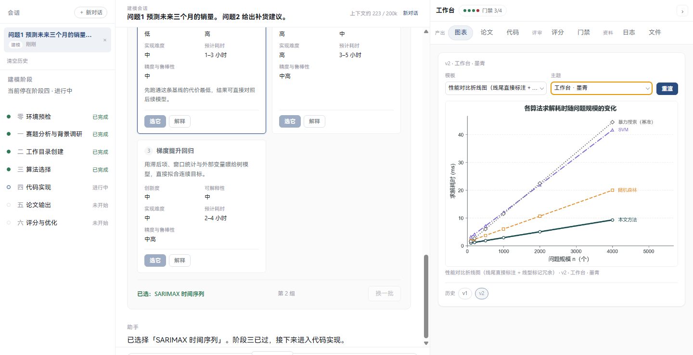
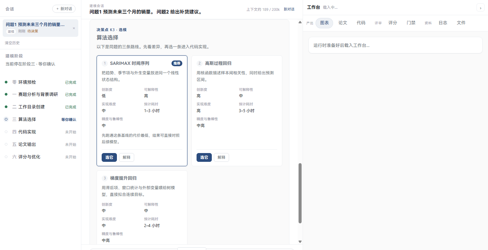
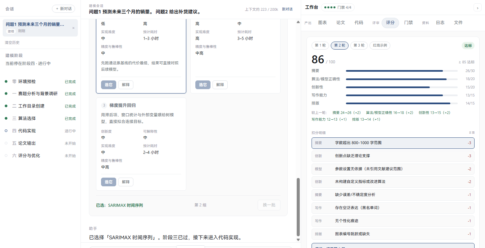
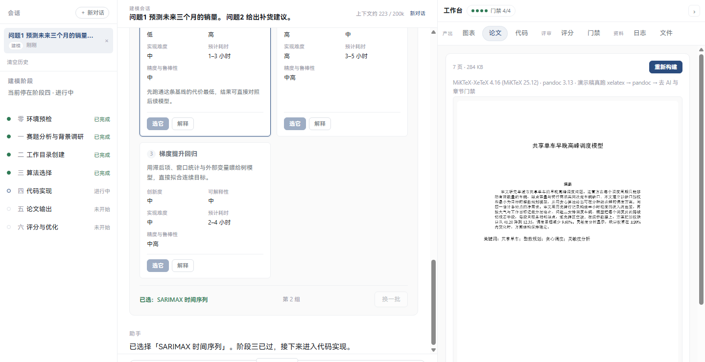
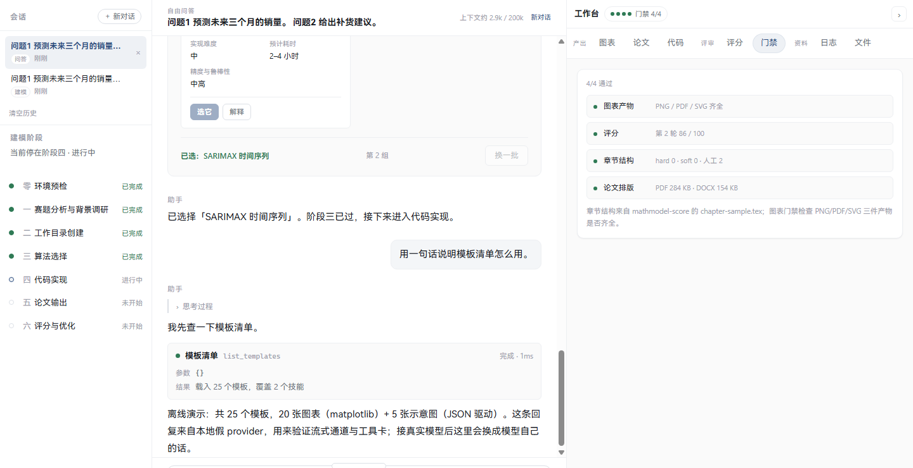
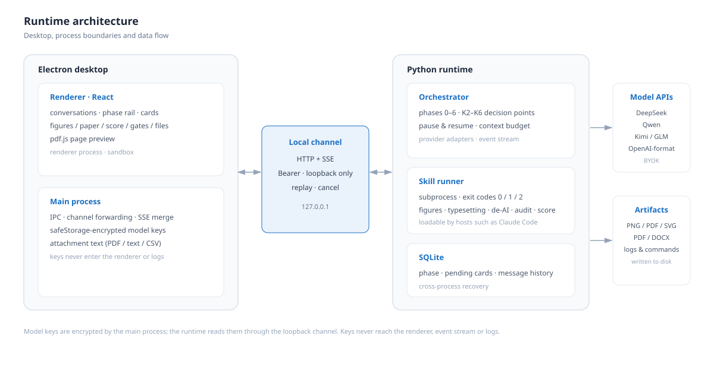
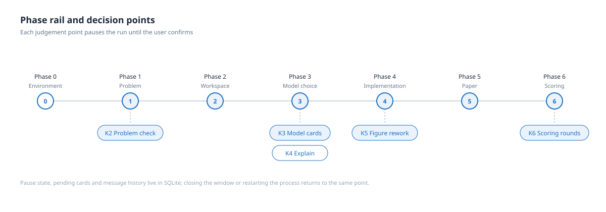

<h1 align="center">MathModel Studio</h1>

<p align="center"><b>A local desktop agent for mathematical modeling contests · a human-in-the-loop workbench</b></p>

<p align="center">
  From problem statement to paper, the judgement calls stay with the user:<br>
  model rationale, explanations, gate verdicts and scoring details remain visible, queryable and reversible.
</p>

<p align="center">
  
  
  
  
</p>

<p align="center">
  <a href="README.md">简体中文</a> &nbsp;·&nbsp; <b>English</b>
</p>

---

<p align="center">
  
</p>

> **Design principle**: anything a machine can verify goes to a gate; anything that requires judgement stays with the user, with each decision point rendered as UI.
>
> This tool integrates a contract-driven skill set (publication-grade figures, typesetting rules, AI-trace checks, structural audit and scoring) into a local desktop program: the model is provided by the user, data stays on the machine, and every step is auditable.

## Overview

MathModel Studio targets contestants and researchers who are already working through a modeling problem. It does not replace modeling judgement; it organizes phase progression, model selection, figure rework, paper typesetting and delivery checks into an auditable workflow.

- **Local first**: the desktop shell and the Python runtime both execute on the local machine; model keys are encrypted with the system secure store.
- **Human in the loop**: phase progression pauses at key decision points and waits for confirmation; pending state survives process restarts.
- **Contract driven**: skills are constrained by a registry, JSON Schemas and CLI exit codes; the UI is generated from the registry rather than a hard-coded skill list.
- **Reviewable evidence**: gates, scoring and CI assertions provide readings and negative coverage.

## Interface

Screenshots are captured at 1440×900 from the real UI; conversation content comes from the offline demo and contains no real problem statement or key.

| Model choice and explanation | Scoring and deduction targets |
| --- | --- |
|  |  |
| K3 model cards: candidate routes, aligned fields and Choose / Explain | K6 scoring: five dimensions, deductions and in-text targets |

| Paper typesetting | Conversation and tool cards |
| --- | --- |
|  |  |
| Paper tab: xelatex → pandoc → three gates and page preview | Conversation flow, tool cards and the four-row gate result |

## Status

**0.6.0 (2026-10-31)**. This release adds multi-conversation management, five provider entry types (DeepSeek, Qwen, Kimi, Zhipu GLM and OpenAI-format endpoints), 200k / 400k / 1m context budgets, medium / high / max thinking depth, and a collapsible right-hand workspace.

The paper tab runs the full typesetting chain: xelatex twice → pandoc to DOCX → Word restyle → de-AI phrasing, structural metrics and chapter-structure gates; PDFs are previewed page by page with pdf.js. The current build target is the bundled demo paper; the phase machine does not mark phase five passed merely because a build succeeded.

M6 packaging is wired up: electron-builder with a bundled portable Python and pandoc; an NSIS x64 installer has been built locally but not yet verified on a clean machine.

Milestones are listed in [PLAN.md](PLAN.md) §7; verified claims and open items are recorded in [docs/HANDOFF.md](docs/HANDOFF.md).

## Quick start

```bash
# Install. On mainland networks read docs/env-setup.md first: direct npm and github.com are both unreliable
npm install
python -m pip install -r requirements.txt -i https://pypi.tuna.tsinghua.edu.cn/simple/

# Launch the desktop app. Without a key, prefix MMS_FAKE_PROVIDER=1 for the offline demo
MMS_FAKE_PROVIDER=1 npm run dev

# Validate the runtime without a model: list 25 templates and render one figure (PNG/PDF/SVG)
npm run mms -- templates
npm run mms -- invoke figure paired-raincloud

# Run every local gate: registry, skill spec, negative coverage, typecheck, build, dist smoke, contracts, CLI, channel, workbench and paper
npm run gate
```

A passing `npm run gate` means the scaffold is self-consistent and needs neither network nor a display. The paper self-check requires `xelatex` and `pandoc` on the machine (see Dependencies).

## Capabilities

### Phase orchestration and decision points

Phases zero to six (environment preflight, problem analysis, workspace layout, algorithm selection, implementation, paper output, scoring) are mapped onto a status track that shows where the agent is blocked. Key points pause as decision cards:

- **K2 Problem and attachment confirmation**: subproblem decomposition, attachment and data roles, per-question data mapping.
- **K3 Model-choice cards**: two to three candidates with core idea, novelty, explainability, implementation difficulty, estimated effort and accuracy expectations; reroll is supported.
- **K4 In-place explanation**: opens an explanation drawer without clearing the pending choice.
- **K5 Figure rework**: switch template or theme, re-render and roll back; after a re-render only the current version is shown and older versions move into history.
- **K6 Scoring and optimization rounds**: five dimensions, deduction targets, a three-round circuit breaker and a veto example.

### Conversations and context

The left rail is a conversation list: modeling sessions are read from SQLite and chat sessions are stored locally; sessions can be created, switched, deleted individually or cleared. Switching restores messages, attachments, phase and pending cards. The chat header shows the active conversation and context usage, loaded backwards from the latest message within a 200k / 400k / 1m budget.

### Model access

The settings page organizes five provider types in a list, with preset or manually entered model names. Keys are encrypted by the main process via `safeStorage`; the offline demo runs without a key. See [docs/providers.md](docs/providers.md).

### Figures and papers

The figure workbench calls the real renderer to produce PNG/PDF/SVG and keeps the reproducible command and run logs. The paper tab runs xelatex, pandoc, Word restyling and three delivery gates, with a pdf.js page preview.

### Files and workspace

The files tab lists the workspace and can switch directories; the default workspace is a `赛题` folder on the Desktop, created on first launch. Attachments can be dropped or pasted into the chat column; the main process extracts their text (pdfjs for PDFs, direct reads for text/CSV with row × column counts).

## Architecture

<p align="center"></p>
<p align="center"></p>

The desktop shell and the Python runtime communicate over a loopback channel (HTTP + SSE); model keys are encrypted by the main process only. Phase progression pauses at K2–K6 decision points, and phase, pending cards and message history are persisted in SQLite so they survive process restarts.

## Skills

[`skills/manifest.json`](skills/manifest.json) is the single source of truth; the row count below and the badge count above are enforced equal by CI.

| Skill | Responsibility | Status |
| --- | --- | --- |
| [`mathmodel-core`](skills/mathmodel-core/) | Orchestration and routing across phases 0–6 | built-in |
| [`mathmodel-methods`](skills/mathmodel-methods/) | Method library and selection: problem-family index, rationale, verification | built-in |
| [`mathmodel-paper`](skills/mathmodel-paper/) | Writing and typesetting: rules, LaTeX skeleton, Word output, references | built-in |
| [`mathmodel-figure`](skills/mathmodel-figure/) | Data figures: matplotlib template library and Nature drawing standard | built-in |
| [`mathmodel-diagram`](skills/mathmodel-diagram/) | Academic diagrams: JSON-driven layout templates and faithful replication | built-in |
| [`mathmodel-deai`](skills/mathmodel-deai/) | De-AI and delivery checks: lexical, structural and character-level gates | built-in |
| [`mathmodel-score`](skills/mathmodel-score/) | Structure audit and scoring: chapter gate and a 100-point five-dimension rubric | built-in |

The seven skills ship as source with this repository (Apache-2.0); versions and import history are recorded in [`skills/VENDOR.md`](skills/VENDOR.md). The runtime only calls skill scripts via subprocess and reads their exit codes, so each skill remains independently loadable by hosts such as Claude Code.

## Gates and evidence

Every gate ships with negative coverage: a checker that only ever returns zero is not evidence.

| Gate | Criterion | Negative control |
| --- | --- | --- |
| G1 registry consistency | registry, skill directories, contract vocabularies and both README skill tables and badge counts agree | eight seeded breakages, each must turn red (`npm run check:registry:negative`) |
| G8 skill specification | every `SKILL.md` is a valid Agent Skills entry: parseable frontmatter, name matching the directory, non-empty description within 1024 characters, no repository-private fields | six breakages built from the real files must turn red (`npm run check:skills:negative`) |
| G2 contract validation | registry validated against JSON Schema Draft 2020-12; degrades with a printed note when `jsonschema` is absent | two deliberately invalid registries must be rejected |
| G2b version parity | `VERSION`, `package.json`, `pyproject.toml` and `mms/__init__.py` agree | any missing or differing value fails |
| G3 CLI contract | exit codes 0/1/2 are reachable; the renderer is actually invoked and PNG/PDF/SVG artifacts are verified | out-of-vocabulary values, invalid JSON, empty `MMS_HOME`, unknown subcommands/templates and a renderer that fakes success are all rejected (`runtime/selfcheck.py`) |
| G4 event stream | handshake, Bearer token, loopback Host/Origin allow-list, nine SSE event types, replay and cancellation; covers K2/K3 pause-and-resume and cross-process recovery; 0.6.0 adds thinking depth, the off switch and context trimming (52 assertions) | ten malformed events must be rejected; missing token, wrong Host and resuming without a pending decision are refused (`python runtime/selfcheck_channel.py --selftest`) |
| G5 provider offline contract | a local fake endpoint covers 429 backoff, `reasoning_content` separation, split `tool_calls` assembly, reasoning stripped from history and key transmission boundaries | key sentinels must never reach the event stream or stderr; the fake provider is refused when offline mode is off |
| G6 desktop scaffold | typecheck and build, plus verification that the bundle contains this project's Chinese copy and design tokens | any failed assertion exits 1 (`scripts/smoke-dist.mjs`) |
| G9 workbench | two real renders, version history and rollback, unknown template/theme/version rejected without adding a version; three scoring rounds, deduction targets, chapter sample and veto example (13 assertions) | unknown template/theme/version are negative controls (`runtime/selfcheck_workbench.py`) |
| G10 paper typesetting | xelatex twice → pandoc → Word restyle: PDF/DOCX magic and size, six steps, three gates and persisted state (10 assertions) | four negative controls (missing tools, bad paper, broken TeX, missing source); skipping requires `MMS_PAPER_SKIP=1` and prints that G10 was not verified |
| G7 real launch | launches the production entry and asserts built artifact, 1440×900, non-white pixels, IPC, real CJK glyphs and that keys are never echoed; covers K2→K3→explain→choose, figure re-render and rollback, scoring, paper build and preview, attachments, multi-conversation, five provider presets, context and thinking depth, and the collapsed workspace (97 assertions) | blank screenshots, self-built windows, tofu glyphs and deleted key assertions have all been caught (`tests/window-smoke.cjs`) |
| G6b result audit | reads the smoke JSON and recomputes the readings: content size, non-white ratio, assertion floor, key assertions and self-reported counts | `--selftest` with 12 synthetic results proves that fake greens are rejected (`scripts/check-window-smoke.mjs`) |

## Verification status

Local verification for 0.6.0 covers typecheck, build, G4 52/52, G7 97/97 and the G6b audit. CI run [`41172805948`](https://github.com/Escap1ng/mathmodel-studio/actions/runs/41172805948) is green in all three jobs: ubuntu real launch 97/97 at 1440×900 with 4.16% non-white pixels and an agreeing G6b audit; both the ubuntu and windows gate jobs pass, with the Windows G10 explicitly skipped and marked unverified.

The M6 NSIS x64 installer has been built locally (`mathmodel-studio-0.6.0-setup.exe`, about 264 MB, unsigned, Electron default icon) but not yet installed on a clean machine.

Not covered: real networked conversations with any of the five providers (no key is included in this repository), launching a window on Windows in CI, active probing of CSP violations, and installing/running the installer on a clean machine. Historical CI runs and readings are recorded in [CHANGELOG.md](CHANGELOG.md).

## Dependencies

| Purpose | Requirement | Note |
| --- | --- | --- |
| Desktop shell | Electron, electron-vite, React, TypeScript | see `package.json` |
| Runtime | Python 3.12+ | the channel server, SSE and provider client are standard-library only; `jsonschema>=4.20` is optional and validation degrades without it |
| Model access | DeepSeek, Qwen, Kimi, Zhipu GLM and any OpenAI-format endpoint | see [docs/providers.md](docs/providers.md); keys are encrypted by the main process via `safeStorage` |
| Typesetting | xelatex, pandoc, python-docx | xelatex requires a local install (TeX Live or MiKTeX); pandoc may be bundled, placed on PATH, pointed to by `MMS_PANDOC`, or installed at `%LOCALAPPDATA%\mms-tools\pandoc.exe` |
| Figures | matplotlib, numpy, seaborn | lower bounds are in `requirements.txt`; install via a mirror |
| Paper preview | pdfjs-dist | installed by `npm install`; the worker is bundled by Vite and needs no network at runtime |

## Packaging and distribution

Packaging is decided and wired up: a portable Python runtime is bundled (python-build-standalone under `vendor/python`, not committed), and pandoc ships as `vendor/pandoc/pandoc.exe` under `resources/pandoc`; xelatex still requires a local install and TeX is not bundled. The NSIS x64 configuration lives in `electron-builder.yml`, and the bundled toolchain is prepared by `scripts/prepare-vendor.mjs`. The current installer is unsigned and uses the default Electron icon.

## Compliance

This tool assists modeling work that has already been done: typesetting, publication-grade figures, pre-delivery self-audit and method-selection discussion. It does not replace modeling judgement and does not promise an award. The bundled scoring and structure checks default to the Chinese national contest rubric (aligned to the 2026 format rules) and can be switched to MCM/ICM; AI-trace checks only remove template phrasing and invisible characters and never present unperformed work as performed. Fabricating results, references or data is a hard red line. Follow your own contest's rules on generative tools.

## License

[AGPL-3.0-only](LICENSE). This repository is released as a whole under AGPL-3.0-only; distributing the software or a modified version requires providing the corresponding source under that license. Files under [`skills/`](skills/) that are Apache-2.0 retain their original license and notices; versions and provenance are recorded in [`skills/VENDOR.md`](skills/VENDOR.md).
